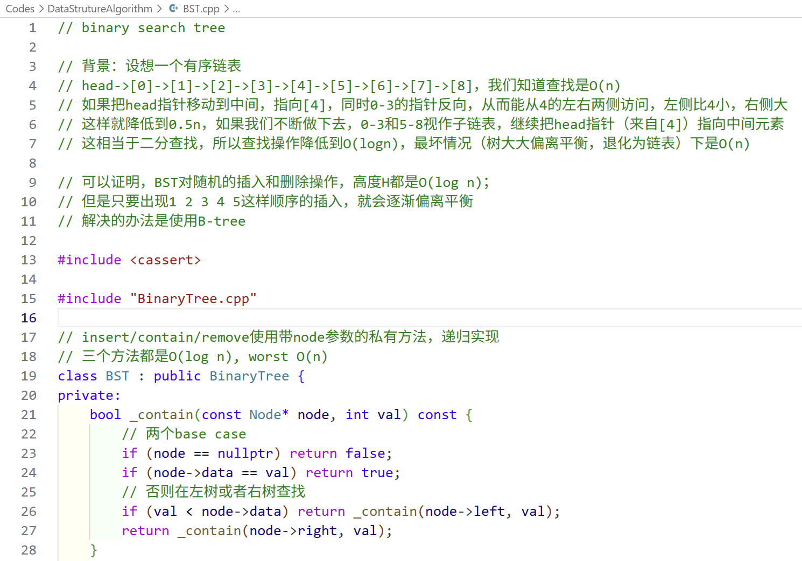

# easy-dsa-cpp

学习数据结构与算法的自用笔记，一个简单cpp仓库，内容包括

- UCB CS61B的课内部分，用cpp而非java实现
- 其他常见的数据结构课程内容，比如KMP、优先队列等
- mycodeschool的内容，特别是二叉树部分

这些内容完全可以让AI写（事实上本仓库的不少代码也是AI改的），本仓库的区别在于

- CS61B课程笔记的大量注释，关注不同数据结构之间的演化，以及我自己实现时遇到的问题“为什么”
- 大部分数据结构都储存int，不用任何模板，重点是搞清楚实现思路
- 只实现最关键的方法
- 默认读者已经初步学习过这部分的理论知识，只是没有自己写过实现。因而我不会解释什么是循环队列和线性队列，只是提供从线性队列到循环队列的变化和好处
- ~~可能有不少没检查出来的错误~~

## 顺序

根目录下是CS61B课程的内容

- SLList：单向链表，带哨兵节点的实现
- DLList：双向链表，哨兵+循环的实现
- AList：用数组实现链表
- More/Stack：栈，数组和链表实现
  - algorithm/expression：前缀表达式求值，转化相关
- More/Queue：队列，循环数组、带尾指针的链表
  - More/Deque：双端队列，循环数组
  - PriorityQueue：优先队列，数组、二叉堆实现（*这部分CS61B是在Hash后面讲的，我的实现主要参考自己课堂上的内容*）
- algorithm/KMP：字符串匹配的KMP算法，前缀函数、next数组
- BinaryTree：二叉树，重点遍历（*这部分CS61B也是在Hash后面讲的，同上*）
  - BST：二叉搜索树，重点插入/删除/查询，递归写法
- B-tree：给定参数t的B-tree，**代码略去**
- 旋转平衡树们：
  - Red-BlackTree：LLRB左倾红黑树，只实现插入
  - More/AVLTree：旋转平衡树，参考LLRB来实现
- More/BitSet：集合的位向量实现方法，类似vector<bool>
- Hash：无序set/map的实现方法，哈希表
- Graph：图的邻接表实现
  - GraphTraversal：图的dfs和bfs遍历，迭代和递归，前序和后序

## 其他

请使用cpp23，有些代码使用了print头文件