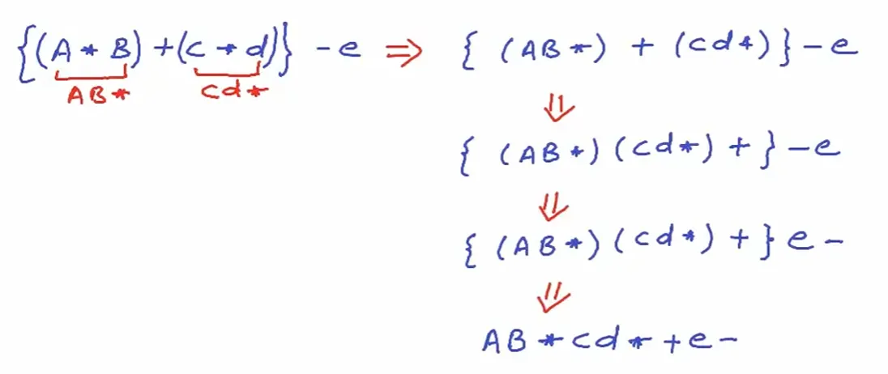

*仅供我自己复习用*

## 数据结构

- 顺序表：数组
- 链表
  - 单向链表 node类data+next；list类存储first（更优雅的实现，储存一个哨兵节点避免列表空指针问题）
  - 双向链表 node类data+next+prev；list类存储sentinel并且循环链表
  - 静态链表 为数组中每一个元素附加一个链接指针
  - 广义表 node类
  - 跳表 2^n位置的特定节点有多个next，用于实现链表的二分查找
- 栈：只可从栈顶读写，先进后出FILO
  - 顺序栈 基于数组，调整top即可
  - 链式栈 基于链表，[top]->[a_n]->...->[a_0]
- 队列：从尾插入，从头删除，先进先出FIFO，需要front+rear两个指针
  - 顺序队列 基于数组
  - 循环队列 基于循环数组
  - 链式队列 基于链表
  - 优先队列 基于线性数组，插入删除都需要调整其余元素；基于堆实现
  - 双端队列 基于循环数组
- 树：存储天然有层次的数据；每个（非叶）节点指向子节点（可以看作一个节点指向子树，递归）；节点的height是由节点到叶节点的最大边数，节点的depth是节点到root的边数（高度到叶，深度到根）；**考试注意：课内定义为节点数，即最小为1**；节点的度是直接孩子的数量
  - 二叉树 node类data+left+right
    - 满二叉树
    - 完全二叉树，最后一层是从左到右填充的
    - 二叉堆：利用完全二叉树的元素下标关系，用数组储存二叉树，有序
  - 线索化二叉树：存储前驱和后继
  - 二叉搜索树：有序链表的遍历查找是O(n)，利用有序性做二分查找，变为O(log n)；把二分查找的过程实现为一种结构，即left小right大
    - 二叉树的中序遍历，就是从小到大的遍历
  - 霍夫曼树：最短编码
  - B-tree：每个节点最多容纳L个元素，有[t,L+1]个子节点（非叶）；如2-3树，每个节点有2/3个子树
  - 旋转平衡树/AVL树：通过旋转维护高度，使得左右子树的高度差不超过1；平衡因子bf，右子树的高度与左子树的高度差
    - LLRB树：维护与2-3树的对应关系
    - 红黑树：维护与2-3-4树的对应关系
  - 对于高维（特征）数据进行排序的树，每向下一层，搜索空间就减少到多个选择之一，对于二叉树是一维数轴减半到左右；适用的任务是range search，寻找给定范围内存在什么元素，以及nearest search，寻找离给定位置最近的元素
    - 四叉树：可以对于(x,y)排序，向下一层就是选定该顶点为原点的一个象限
    - 八叉树：对于(x,y,z)三维数据
    - k-d树：如果只是这样推广二叉树的孩子树，会变得有些复杂，而k-d树能妥善处理k维的数据
- 集合：位向量表示，用0/1代表有无此元素；有序链表表示；红黑树表示；
  - *CS61B的实现：数组、BST、2-3tree、LLRB以及哈希*
- 并查集：以树的形式储存
- 字典：维护键值对
  - 有序数组/有序链表：按照关键码key大小顺序来组织
  - 散列（哈希表）：有时候key是不可比的，或者追求比红黑树log n更好的复杂度。关键在于哈希函数的设计和冲突的处理
- 图：树两个节点之间只能有一条路径，而图无此限制（如无特别说明，这里的图都是简单图，即无自环A-A，无平行边A=B），反过来说一个无环、连通的图就是树；注意英文顶点vertex的复数是vertices
  - 分类：有向图和无向图，（都双向连通时）有向图的边数是无向图的2倍；完全图，所有节点都有到所有节点的边；连通图，所有节点都可达（存在路径）
  - 实现：
    - 邻接矩阵 Adjacency Matrix
    - 邻接表 Adjacency List：遍历所有边O(V+E)
  - 遍历：
    - DFS：递归/栈实现；前序/后序指的是action（比如打印）和访问邻居的先后顺序，前序对应dfs call的顺序，后序对应dfs return顺序
    - BFS：队列的实现
  - 有权图中的问题
    - 最短路径：从给定的某个节点作为起点，到所有节点的最短路径构成一个树，即最短路径树Shortest Path Tree/SPT
      - 单源、非负权值：Dijkstra，类似UCS，贪心
      - 多源（所有顶点都依次作为起点）：Floyd
      - 这两个算法无论有向图还是无向图都适用
    - 生成树Spanning Tree：给定一个无环图G，如果G的子图连通、无环、且包含G中的所有节点，则该子图是G的生成树（前两条性质说明是树）。若图中有n个顶点，则树有n-1条边。生成树是图的性质，没有最短路径树中起点的概念
    - 最小生成树MST：使得整个树的权的总和最小；如果有等权值的边，MST可能不唯一
      - 克鲁斯卡尔Kruskal算法：贪心，添加边
      - 普里姆Prim算法：贪心，添加顶点
      - 前者适合边稀疏的场景
      - 实际上这两种方法都是图的割集cut 性质的应用，连接图的两个割集中最小权值的路径必然是MST中的一条边。Prim算法随机选择一个顶点，将图分为该顶点和其他的割集，不断添加最小权的边，扩大该割集然后继续；Kruskal算法则是选择最小的边，图被分为边的一个顶点（连接到已有的树上的）和其他部分，因为确保不形成环，这两个部分必然是割集
  - 活动网络：用图组织有先后依赖顺序、或者平行关系的事件
    - 顶点表示活动AOV
      - 检测有向环：如果能拓扑排序（排成一个线性序列，让前驱关系都满足），则无
    - 边的权值表示活动持续时间AOE：无有向环的带权有向图
      - 

## 算法


## 课件

### Lesson 2

#### 线性表三操作的代价

统一公式是对次数的频率加权求和。注意i的意义，求和过程都是等差数列，直接套首项+末项的这个公式

**搜索的平均比较次数**，ACN(Average Comparing Number)，平均指的是每个元素都有相等的机会被搜索，故p=1/n

- 搜索成功，搜索[0]需要比较1次，以此类推，$\text{ACN} = \frac{1}{n} \sum_{i=0}^{n-1} (i+1) = \frac{n+1}{2}$
- 搜索不成功，需要比较到数组尾才能知道，故比较n次

**插入的平均数据移动次数**，AMN(Average Moving Number)，平均指的是每个位置都等可能的被插入，对于一个有n个元素的表，有n+1个间隙位置，故p=1/(n+1)
假设在第i个位置插入，即[i-1]元素前面插入，[i-1]到[n-1]都需要后移一位，所以总的移动项数是(n-1)-(i-1)+1=(n-i+1)项
故 $\text{AMN} = \frac{1}{n+1} \sum_{i=1}^{n+1} (n-i+1) = \frac{n}{2}$

**删除的平均数据移动次数**AMN，平均指的是每个位置的元素等可能的被删除
删除[i]元素，[i+1]~[n-1]都需要前移一位，总共移动(n-i-1)项
故 $\text{AMN} = \frac{1}{n} \sum_{i=0}^{n-1} (n-i-1) = \frac{n-1}{2}$

但是**最快的方法是取最大最小的平均**，比如搜索，最小是搜索第一项比较1次，最大是搜索到最后一项n次，取平均就是答案。可以用来检查答案

#### 约瑟夫问题

循环链表，模拟；数组+取余模拟

```cpp
int n = 8, m = 3;
int pos = 0;
vector<int> arr(n);
for (int i = 1; i <= 8; i++) arr[i - 1] = i;
while (arr.size() != 1) {
  pos = (pos + m - 1) % arr.size();
  arr.erase(arr.begin() + pos);
}
```

如果利用cpp的STL库，还是数组模拟方便

#### 多项式相加

单向链表（带表头），每个节点存储coef exp next

1) 当pa和pb没有检测完各自的链表时，循环执行以下指令，否则执行步骤2
比较 pa 和 pb 当前检测结点的指数域。若
- 指数不等：小者加入C链，相应检测指针pa或者pb进1
- 指数相等：对应项系数相加。若相加结果不为零，则结果加入C链，pa与pb进1

2) 当pa或pb指针中有一个为NULL，则把另一个链表指针不为NULL的剩余部分加入到C链

#### 多项式相乘

最简单的方法是用map，多项式本身就是多个exp->coeff的映射，如果exp相同，map会自动合并

```cpp
Polynomial multi(Polynomial& a, Polynomial& b) {
  Polynomial ans;
  for (auto term1 : a) {
    for (auto term2 : b) {
      ans[term1.first + term2.first] += term1.second * term2.second;
    }
  }
  for (auto it = ans.begin(); it != ans.end();) {
    if (it->second == 0) {
      it = ans.erase(it);
    } else {
      ++it;
    }
  }
  return ans;
}
```

### Lesson 3

- 可能的出栈序列：catalan数，$\frac{C_{2n}^n}{n+1}$
- 双栈共享空间【无完整类的实现】
  - 空：`t[0] == -1` / `t[1] == M`，满：`t[0] + 1 == t[1]`
  - push/pop：用d区分是左还是右
- 括号匹配问题：基于栈
  ```cpp
  bool isValid(const string& s) {
    stack<char> temp;
    for (char c : s) {
      switch (c) {
        case ')': {
          if (temp.empty() || '(' != temp.top()) return false;
          temp.pop();
          break;
        }
        case ']': {
          if (temp.empty() || '[' != temp.top()) return false;
          temp.pop();
          break;
        }
        case '}': {
          if (temp.empty() || '{' != temp.top()) return false;
          temp.pop();
          break;
        }
        default:
          temp.push(c);
        }
    }
    return temp.empty();
  }
  ```
- 表达式求值：中缀后缀表达式求值，和中转后
  - 人工转换：先给中缀表达式的所有项加上括号，一项一项改为后缀，最后去掉括号
  
  - 中缀转后缀：栈底先压结束符，读取一个`ch`：
    - 操作数：直接输出
    - 比较栈外优先级`icp(ch)`和栈内`isp(op)`：
      - 大于：ch进栈
      - 小于：op退栈并输出，继续比较下一个op
      - 等于：op退栈但不输出（只会发生在括号和结束符配对，因此不会输出），若弹出的是 `(` 则读下一个字符
    - 读到 `#` 且栈顶为 `#`：退`#`，结束
- 队列的不同实现
  - 循环队列：注意rear的意义是队尾元素本身，还是指向下一个
  - 链式队列：注意带不带头节点
- 用队列打印杨辉三角

### Lesson 4

- 多维数组的下标计算：初始地址`a`，每个元素`l`个字节，下面直接给出如[i][k]的地址公式，做的时候只需要知道行数和列数【背诵】
  - 一维：`LOC(i) = a + i*l`
  - 二维(m,n)：`LOC(j,k) = a + (j*n + k)*l`
  - 三维(m,n,t)：`LOC(i,j,k) = a + (i*n*t + j*t + k)*l`
  - 变式情况：优先顺序改变，但是[i][j][k]依旧代表页行列
    - 二维(m,n)列优先：`LOC(j,k) = a + (k*m + j)*l`
    - 三维列行页顺序：`LOC(i,j,k) = a + (k*m*n + j*m + i)*l`
- 对称矩阵的存储：上三角和下三角，特点是`A[i][j]=A[j][i]`，套公式之前确定一下是所在三角区域内的元素【本质画图题+待定系数】
  - 下三角，行优先：横向求和i次，$1+2+\cdots+i+j = i(i+1)/2+j$
  - 上三角，列优先：竖向求和j次，$1+2+\cdots+j+i = j(j+1)/2+i$
  - 变式：
    - 下三角，列优先：竖向求和j次，$n+(n-1)+\cdots+(n-j+1)+i = (2n-j+1)j/2+i$
  - 反求ij即根据约束（上下三角）找正整数解
  - 三对角矩阵：共$(n+n-1+n-1)=3n-2$个元素，下标变换是线性变换，直接待定系数（带状矩阵同理）
    - 约束条件：$i-1 \leq j \leq i+1$
    - `A[i][j]` -> $2i+j$
  - 这些都可以自行临场画一个矩阵，然后找关系；**注意index的起点是0还是1**
- 稀疏矩阵：存储应该只存储非零值【无需掌握代码】
  - 三元组表示，数组储存：只保存(i,j,val)
    - 快速转置算法：三元组是行优先存储的，行就是转置前的列，所以首先遍历所有三元组，取出列号col，用来统计原本的每列非零元个数`rowSize[col]++`，接着计算前缀和数组`rowStart[i] = rowStart[i-1]+rowSize[i-1]`代表该列的起始位置，最后再遍历三元组，按照`j=rowStart[col]`作为转置后的下标放置，再给`rowStart[col]++`
    - 相加算法
  - 正交链表表示【疑似不考】
- KMP算法：模式匹配，**考试注意：使用next和pi的不同**
  - 前缀函数（next数组相当于pi数组右移一位，然后首位填-1）
  - 匹配写法（next数组写法是`j = next[j];`）
- 广义表【不考代码】
  - 给定括号逗号式子，计算长度、深度
  - 使用head、tail取出元素，注意tail得到的是去掉头元素的子表
  - 画图，节点的三个属性，utype、info、link：(0,ref,)、(1,data,)、(2,listlink,nextlink)；每个表都有一个表头节点

### Lesson 5

- 二叉树的数学性质
  - 第i层最多2^(i-1)个节点
  - n0 = n2 + 1（证明：总节点个数n = n0 + n1 + n2；从出边和入边算两次总连接数e = n-1 = 2n2 + n1）
  - 完全二叉树：（**自己画一个树找规律**）
    - n个节点，深度是向下取整log(n)+1，叶子数是上取整n/2
    - 层序1-base，父节点是[i/2]，左子女2i，最后一个分支节点是[n/2]
    - 层序0-base，父节点是[i-1/2]，左子女2i+1，最后一个分支节点是[n-2/2]
- 从广义表创建二叉树：利用栈，`(`把之前节点进栈，`)`出栈，`,`切换左右节点标志
- 二叉树的递归与**非递归**算法
  - 前、中、后序遍历：递归，非递归利用栈（注意**非递归和我的代码不同**）
    - 前序非递归：循环条件是指针非空，访问中；预留右指针入栈；如果左指针非空，进左子树，为空p取栈顶（右）
    - 中序非递归：循环条件是指针非空或栈非空，一直把当前指针入栈，然后移动到左子树；此时指针空，如果栈非空，p取栈顶，访问，然后移动到右子树
    - 后序非递归：类似中序，先一直入栈自己+移动左子树，标记L；继续循环；然后p取栈顶，如果标记是L，把p改R重新入栈，移动到右子树，如果标记是R，说明访问自己
  - 通过前序创建二叉树：空指针也会给定，递归算法
  - 通过前序遍历输出二叉树（广义表形式）：先打印根，当左右子树都存在再依次打印`(`，递归左子树，`,`，递归右子树，`)`
  - 给定前序+中序，或者后序+中序，可以确定一个二叉树（前序开头判断根，后序结尾判断根，再看左右子树）
- 线索化二叉树：已有一个n个节点的树，利用剩余的n+1个**空指针**域（后面代码都是，只有空孩子指针才建立线索）
  - 中序线索二叉树：按照中序进行线索化
    - 给定root为根的树，first/last是中序下的第一个和最后一个节点；给定一个节点，next/prior是前驱和后继；这些都用迭代
    - 建立线索化，递归建立左子树，建立当前节点的前驱，建立先前节点的后继为该节点，递归建立右；最后剩一个中序的结尾节点，单独处理它的后继为空
  - 前序、后序：只需要掌握前驱和后继的确定
- 树的其他储存方式
  - 子女-兄弟表示（左孩子右兄弟）：可以转化成二叉树
- 树的遍历方式：深度优先和广度优先
  - 深度优先：先根次序=二叉树表示的前序，后根次序=二叉树表示的**中序**
  - 广度优先：
- 最大堆、最小堆：用数组储存完美二叉树
  - 这个堆和计算机内存所谓的堆栈没有什么关系
- huffman树：WPL达到最小的扩充二叉树，有相同权值时构造不唯一
  - 路径长度PL：到根节点的**边数**；外部路径长度EPL是从叶到根，故PL=EPL+IPL；WPL：带权路径长度
  - 扩充二叉树：叶节点赋予一个权重，此时必须区分内外节点；**只有度 0 的外结点和度 2 的内结点**，n 个外结点 ⇒ n−1 个内结点 ⇒ 共 2n−1 个结点
  - 人工生成的方法：选取最小的两个树合并、代码（借助最小堆维护）
  - huffman编码：不等长编码，利用不同符号的频率差异分配不同码长，从而节省空间
    - 手写方法：频率整数化权重，建树，左0右1，
    - 总编码长度正好等于Huffman树的带权路径长度WPL
    - 前缀编码，即任一个二进制编码不是其他二进制编码的前缀，解码时不会混淆

### Lesson 6

在搜索过程中关键码**平均比较次数**，也称为平均搜索长度ASL，公式是$\sum_i p_i c_i$

和Lesson2一样的，顺序表的ASLsucc可以通过最大最小取平均快速计算；失败的情况就不行了，因为不是等差数列，失败的情况前面Lesson2也没有出现过

- 集合
  - bitset
    - 实现：大包的地址ad是[x/16]，小包的地址id从小的下标开始（和我的实现相反），偏移是[x%16]
    - 取数：`return ((elem >> (15 - id)) %2);`，右移15-id之后最低位就是目标
  - 大小有序链表的set（类似多项式）
    - 插入、删除
    - 并、交、差
- 并查集：父指针表示，初始化-1，负数代表是根，绝对值是树的节点树数（包括根自己），正数代表是子节点，值是连接到的节点
  - find/root：一直遍历到>=0
  - union/connect：朴素连接；按权连接，把小树接到大树上
  - 路径压缩：避免树退化
- 字典
  - 顺序数组和顺序链表：ASL树
  - ASL成功和失败的平均路径长度计算，默认所有元素的查询概率均等
    - 顺序搜索：n个元素，成功情况下第i个元素需要i次；失败情况有n+1种（n个产生n+1个间隙），注意对于第n个元素，分小于和大于，所有求和式是求和到n，再+n
    - 折半/二分搜索：按照搜索情况画出BST树，无论成功还是失败都按照比较次数计算即可，**注意失败有n+1种情况**
  - 跳表的搜索规则
  - 哈希【不考代码】
    - 哈希函数：ax+b直接处理；数字分析，取最均匀的若干位；除留余数，表大小m，取比m小的最大质数，取余；平方取中；折叠，顺序移位和S形折叠
    - 冲突处理：
      - （闭散列/开地址法）线性探查，取后面的位置；平方探查，取之后i^2；二次探查，交替取之前之后i^2，要求表的大小是4k+3质数；二次散列，取后面i*hash2(key)的位置，要求hash2的结果和表大小互质；
      - （开散列/链地址法）桶方法，冲突项依然放在一个[key]里，利用链表
    - 考点：
      - 给关键字得到哈希表，建立表的时候就应该**记下该元素的比较次数**
      - 搜索ASL平均路径计算：成功情况看每个**已有**的元素，模拟比较次数的总和；失败情况是搜索**所有可能**关键字（即表的大小）探查到第一个空桶的比较次数，对于没有元素的位置，只需要1次比较就知道是空的，对于有元素的，按照探查方法而定
      - 注意：**mod R作为哈希时**，[R]不是一个可能的关键字，失败情况不计入，不过这个位置依旧可以放元素（比如数组[0..11]，一般而言失败是12种，如果使用mod11哈希就只有0-10共11种了；桶方法里，成功情况依旧除元素个数，失败情况是一直比较到**再比较一次nullptr**（其实也就是探查到第一个空桶为止）才算，除所有可能关键字

### Lesson 7

搜索数据结构

- 数组的搜索
  - 尾部添加，删除元素由尾部元素来填补
  - 使用监视哨的顺序搜索：在数组的末尾[size]处设置key为查找的x，循环条件从`while(i < size && data[i].key != x)`变为`while(data[i].key != x)`，循环判断条件减少一半
  - 顺序搜索和二分搜索的ASL树（之前已经出现过）
- 二叉搜索树BST
  - 查找、插入、删除
- AVL树（课件使用bf实现）
  - 四个旋转操作：左、右、左右、右左；不同节点的连接情况使用什么操作
    - bf改变：原本是平衡的，根为1/-1，具体看树如何倾斜；添加节点之后，自行画树的变化；对于单旋转，后bf=0，对于双旋转，bf按照插入位置的节点的bf讨论，表格
  - 插入：被插入节点的父节点的bf分类，为0无事发生；为1/-1考察父节点向上；为2/-2立刻旋转，旋转结合父节点的bf+子节点的bf讨论树的四种形状，然后使用四种旋转（即我的实现中的rotate）【课件中没提供代码】
  - 删除：被删除节点只有一个子女可以按照BST的方法简单删除，然后更新高度；两个子女时要追加一个shorter bool变量，追踪该子树的高度变化【课件中没提供代码，但是可能给树让你画删除的情况和用的旋转操作】
  - 树高度的计算

### Lesson 8

- 图的概念：带权图叫网络；生成树不是唯一的（有环的时候）
- 图的存储实现（课件给出的是带权图的代码）
  - 邻接矩阵
    - 对于n个节点，存储一个n^2的bool矩阵，用于保存相邻关系；再存储一个vectorList的顶点数组
    - 对于有向图，约定from-to才为true；对于无向图，这个矩阵将是对称的
    - 有权图，例如存储INT，不可达为INT_MAX，正常边为权，到自身为0，所以对角线都为0
  - 邻接表：基于数组+链表，每个节点都存储一个list，代表这个节点的邻居，n个节点整体是一个数组
    - 头节点（Vertex结构体）代表所有顶点，构成是T data和Edge* adj，所有邻居构成的表；邻居节点（Edge结构体）构成是dest(index)和link，如果是带权的还需要cost；最终存储Vertex*的NodeTable
    - 有向图分为入表和出表
  - 构造和析构
- 图的遍历
  - DFS：递归的实现，课件直接打印节点
    - 主方法只负责传入bool* visited和起点的index
    - 辅助方法访问当前+标记，然后递归调用，访问!visited的邻居。代码和我的思路一致
  - BFS：基于队列的实现，大体上一致，区别是
    - 主循环前的开头，课件的实现直接访问起点+入队，我是只入队
    - 主循环，课件里因为起点已经在外部访问了，访问的时机变为内部的while，而我的是主循环的起点
    - 总而言之，课件访问标记入队起点，主循环：出队w，取w的第一个邻居开始，循环访问标记入队所有邻居
- 连通分量
- 最小生成树MST
  - 克鲁斯卡尔Kruskal算法
    - 思路：首先构造一个只有顶点的图T；从E里选取最小权（最小堆）的边(v,w)，然后从E删除该边；如果(v,w)添加到T后不产生回路（并查集），则加入T，否则放弃(v,w)；直到边数到达n-1即成功
    - 实现：最小堆存储MSTEdgeNode(head,tail,cost)，按照cost排序；加入(v,w)前，并查集检查v和w是否已经连接；count计数现在已有的边数
  - 普里姆Prim算法
    - 思路：首先从原图选择一个顶点u0放入生成树顶点集合U（集合），u0的边加入堆H；然后循环，选定H内的最小权的边(u,v)，v不属于U（维护的堆里其实也没有这种边），则E中删除该边，U中加入v；直到边数到达n-1即成功
    - 实现：最小堆类似，向最小堆里插入新边的时候，只有符合一个在，一个不在才会加入最小堆；生成树顶点的集合bool*；选定边加入的时候要维护集合和堆
  - 边稀疏和密集的适用情况
- 最短路径
  - 单源，非负：Dijkstra
    - 思路：先对起点的邻居进行预处理；放入起点，选取最小权的边添加
    - 实现：维护dist和path，以及S布尔数组标记当前的树；课件里没有用优先队列，用遍历找到最小距离的边（min一一比较+u辅助存储）；松弛操作对于所有节点遍历，不只是对邻居，用if约束
  - 多源：Floyd
    - 实现：对于图的邻接矩阵表示，每个矩阵的[i]行其实就是一个最短路径树；只需要记住矩阵的递推式即可，代码很简单，一直迭代n-1即可
    - 看path也如此，固定[i]行之后就和Dijkstra的path使用方法一致
- 活动网络
  - AOV网络的拓扑排序：O(V+E)
    - 思路：循环，选取一个没有前驱的节点，从图删除该节点和从该节点出发的边。直到图为空或者循环跳出还有剩余节点
    - 实现：需要图的入度数组count[]，用count模拟栈，count中既有描述入度的项，又有维护栈的项；先初始化栈，依次入栈入度为0的节点；然后循环n次，只要top!=-1就进行出栈[top]，并维护[top]的邻居的入度，如果邻居的入度变为0立刻进行入栈；如果循环没跳出就top==-1，说明有回路