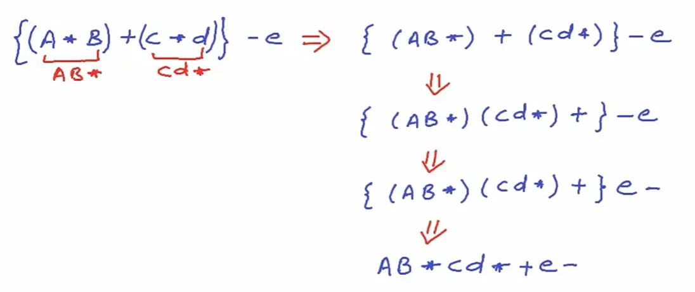

# 数据结构与算法

*仅供我自己复习用*

TODO：各种平均比较次数、搜索路径长度等等

## 大纲

- 顺序表：数组
- 链表
  - 单向链表 node类data+next；list类存储first（更优雅的实现，储存一个哨兵节点避免列表空指针问题）
  - 双向链表 node类data+next+prev；list类存储sentinel并且循环链表
  - 静态链表 为数组中每一个元素附加一个链接指针
  - 广义表 node类
  - 跳表 2^n位置的特定节点有多个next，用于实现链表的二分查找
- 栈：只可从栈顶读写，先进后出FILO
  - 顺序栈 基于数组，调整top即可
  - 链式栈 基于链表，[top]->[a_n]->...->[a_0]
- 队列：从尾插入，从头删除，先进先出FIFO，需要front+rear两个指针
  - 顺序队列 基于数组
  - 循环队列 基于循环数组
  - 链式队列 基于链表
  - 优先队列 基于线性数组，插入删除都需要调整其余元素；基于堆实现
  - 双端队列 基于循环数组
- 树：存储天然有层次的数据；每个（非叶）节点指向子节点（可以看作一个节点指向子树，递归）；节点的height是由节点到叶节点的最大边数，节点的depth是节点到root的边数（高度到叶，深度到根）；**考试注意：课内定义为节点数，即最小为1**；节点的度是直接孩子的数量
  - 二叉树 node类data+left+right
    - 满二叉树
    - 完全二叉树，最后一层是从左到右填充的
    - 二叉堆：用数组储存二叉树，有序
  - 线索化二叉树：存储前驱和后继
  - 二叉搜索树：有序链表的遍历查找是O(n)，利用有序性做二分查找，变为O(log n)；把二分查找的过程实现为一种结构，即left小right大
    - 二叉树的中序遍历，就是从小到大的遍历
  - 霍夫曼树：最短编码
  - B-tree：每个节点最多容纳L个元素，有[t,L+1]个子节点（非叶）；如2-3树，每个节点有2/3个子树
  - 旋转平衡树/AVL树：通过旋转维护高度，使得左右子树的高度差不超过1；平衡因子bf，右子树的高度与左子树的高度差
    - LLRB树：维护与2-3树的对应关系
    - 红黑树：维护与2-3-4树的对应关系
- 集合：位向量表示，用0/1代表有无此元素；有序链表表示；红黑树表示；
  - *CS61B的实现：数组、BST、2-3tree、LLRB以及哈希*
- 并查集：以树的形式储存
- 字典：维护键值对
  - 有序数组/有序链表：按照关键码key大小顺序来组织
  - 散列（哈希表）：有时候key是不可比的，或者追求比红黑树log n更好的复杂度。关键在于哈希函数的设计和冲突的处理
    - 哈希函数：ax+b直接处理；数字分析；取模；平方取中；折叠
    - 冲突处理：线性探查，取后面的位置；二次探查，取之后i^2；二次散列，取后面i*hash2(key)的位置；桶方法，冲突项依然放在一个[key]里，利用链表
- 图：树两个节点之间只能有一条路径，而图无此限制（如无特别说明，这里的图都是简单图，即无自环A-A，无平行边A=B）；注意英文顶点vertex的复数是vertices
  - 实现：
    - 邻接矩阵 Adjacency Matrix：对于n个节点，存储一个n^2的bool矩阵，用于保存相邻关系。对于有向图，约定from-to才为true；对于无向图，这个矩阵将是对称的
    - 邻接表 Adjacency List：每个节点都存储一个list，代表这个节点的邻居，n个节点整体是一个数组。遍历所有边O(V+E)
  - 遍历：
    - DFS：递归/栈实现；前序/后序指的是action（比如打印）和访问邻居的先后顺序，前序对应dfs call的顺序，后序对应dfs return顺序
    - BFS：队列的实现
  - 有权图的最短路径：所有节点的路径构成一个树，可以通过dijkstra进行搜索


## 例题和性质

### Lesson 2

#### 线性表三操作的代价

统一公式是对次数的频率加权求和。注意i的意义，求和过程都是等差数列，直接套首项+末项的这个公式

**搜索的平均比较次数**，ACN(Average Comparing Number)，平均指的是每个元素都有相等的机会被搜索，故p=1/n

- 搜索成功，搜索[0]需要比较1次，以此类推，$\text{ACN} = \frac{1}{n} \sum_{i=0}^{n-1} (i+1) = \frac{n+1}{2}$
- 搜索不成功，需要比较到数组尾才能知道，故比较n次

**插入的平均数据移动次数**，AMN(Average Moving Number)，平均指的是每个位置都等可能的被插入，对于一个有n个元素的表，有n+1个间隙位置，故p=1/(n+1)
假设在第i个位置插入，即[i-1]元素前面插入，[i-1]到[n-1]都需要后移一位，所以总的移动项数是(n-1)-(i-1)+1=(n-i+1)项
故 $\text{AMN} = \frac{1}{n+1} \sum_{i=1}^{n+1} (n-i+1) = \frac{n}{2}$

**删除的平均数据移动次数**AMN，平均指的是每个位置的元素等可能的被删除
删除[i]元素，[i+1]~[n-1]都需要前移一位，总共移动(n-i-1)项
故 $\text{AMN} = \frac{1}{n} \sum_{i=0}^{n-1} (n-i-1) = \frac{n-1}{2}$  

#### 约瑟夫问题

循环链表，模拟；数组+取余模拟

```cpp
int n = 8, m = 3;
int pos = 0;
vector<int> arr(n);
for (int i = 1; i <= 8; i++) arr[i - 1] = i;
while (arr.size() != 1) {
  pos = (pos + m - 1) % arr.size();
  arr.erase(arr.begin() + pos);
}
```

如果利用cpp的STL库，还是数组模拟方便

#### 多项式相加

单向链表（带表头），每个节点存储coef exp next

1) 当pa和pb没有检测完各自的链表时，循环执行以下指令，否则执行步骤2
比较 pa 和 pb 当前检测结点的指数域。若
- 指数不等：小者加入C链，相应检测指针pa或者pb进1
- 指数相等：对应项系数相加。若相加结果不为零，则结果加入C链，pa与pb进1

2) 当pa或pb指针中有一个为NULL，则把另一个链表指针不为NULL的剩余部分加入到C链

#### 多项式相乘

最简单的方法是用map，多项式本身就是多个exp->coeff的映射，如果exp相同，map会自动合并

```cpp
Polynomial multi(Polynomial& a, Polynomial& b) {
  Polynomial ans;
  for (auto term1 : a) {
    for (auto term2 : b) {
      ans[term1.first + term2.first] += term1.second * term2.second;
    }
  }
  for (auto it = ans.begin(); it != ans.end();) {
    if (it->second == 0) {
      it = ans.erase(it);
    } else {
      ++it;
    }
  }
  return ans;
}
```

### Lesson 3

- 可能的出栈序列
- 双栈共享空间【无完整类的实现】
  - 空：`t[0] == -1` / `t[1] == M`，满：`t[0] + 1 == t[1]`
  - push/pop：用d区分是左还是右
- 括号匹配问题：基于栈
  ```cpp
  bool isValid(const string& s) {
    stack<char> temp;
    for (char c : s) {
      switch (c) {
        case ')': {
          if (temp.empty() || '(' != temp.top()) return false;
          temp.pop();
          break;
        }
        case ']': {
          if (temp.empty() || '[' != temp.top()) return false;
          temp.pop();
          break;
        }
        case '}': {
          if (temp.empty() || '{' != temp.top()) return false;
          temp.pop();
          break;
        }
        default:
          temp.push(c);
        }
    }
    return temp.empty();
  }
  ```
- 表达式求值：中缀后缀表达式求值，和中转后
  - 人工转换：先给中缀表达式的所有项加上括号，一项一项改为后缀，最后去掉括号
  
  - 中缀转后缀
- 队列的不同实现
  - 循环队列：注意rear的意义是队尾元素本身，还是指向下一个
  - 链式队列：注意带不带头节点
- 用队列打印杨辉三角

### Lesson 4

- 多维数组的下标计算
  - 三维数组，各个维度的个数是$m_1,m_2,m_3$，则a[i][j][k]的地址是
  $a+(i*m_2*m_3+j*m_3+k)\times l$
  - 如果按照列行页的顺序存放（ijk仍是页行列的序号），地址是
  $a+(k*m_1*m_2+j*m_1+i)\times l$
- 对称矩阵的存储【无需掌握代码】
  - 上/下三角矩阵（首先是方阵），可以用一维数组存储。对于一个下三角矩阵，如果行主序且$i>j$（$i<j$找对称），则
  A[i][j] -> $i(i+1)/2+j$；反求只需找整数解即可
  - 三对角矩阵，A[i][j] -> $2i+j$
  - 这些都可以自行临场画一个矩阵，然后找关系；**注意index的起点是0还是1**
- 稀疏矩阵：存储应该只存储非零值【无需掌握代码】
  - 三元组表示，数组储存：只保存(i,j,val)
    - 快速转置算法：三元组是行优先存储的，行就是转置前的列，所以统计原始的每列非零元`rowSize[col]`，前缀和数组`rowStart[col]`代表该列的起始位置，之后注意扫描A，按照`rowStart[col]++`放置
    - 相加算法
  - 正交链表表示【疑似不考】
- KMP算法：模式匹配，**考试注意：使用next和pi的不同**
  - 前缀函数（next数组相当于pi数组右移一位，然后首位填-1）
  - 匹配写法（next数组写法是`j = next[j];`）
- 广义表【疑似只考概念】
  - 给定括号逗号式子，计算长度、深度
  - 使用head、tail取出元素，注意tail得到的是去掉头元素的子表
  - 画图，节点的三个属性，utype、info、link：(0,ref,)、(1,data,)、(2,listlink,nextlink)；每个表都有一个表头节点
  - 

### Lesson 5

- 二叉树的数学性质（自己画一个树找规律）
  - 第i层最多2^(i-1)个节点
  - n0 = n2 + 1（证明：总节点个数n = n0 + n1 + n2；从出边和入边算两次总连接数e = n-1 = 2n2 + n1）
  - 完全二叉树：
    - n个节点，深度是向下取整log(n)+1，叶子数是上取整n/2
    - 层序1-base，父节点是[i/2]，左子女2i
- 从广义表创建二叉树：利用栈，`(`把之前节点进栈，`)`出栈，`,`切换左右节点标志
- 二叉树的递归与**非递归**算法
  - 前、中、后序遍历：递归，非递归利用栈（注意**后序非递归和我的代码不同**）
  - 通过前序创建二叉树：空指针也会给定，递归算法
  - 通过前序遍历输出二叉树（广义表形式）：先打印根，当左右子树都存在再依次打印`(`，递归左子树，`,`，递归右子树，`)`
  - 给定前序+中序，或者后序+中序，可以确定一个二叉树（前序开头判断根，后序结尾判断根，再看左右子树）
- 线索化二叉树：已有一个n个节点的树，利用剩余的n+1个**空指针**域（后面代码都是，只有空孩子指针才建立线索）
  - 中序线索二叉树：按照中序进行线索化
    - 给定root为根的树，first/last是中序下的第一个和最后一个节点；给定一个节点，next/prior是前驱和后继；这些都用迭代
    - 建立线索化，递归建立左子树，建立当前节点的前驱，建立先前节点的后继为该节点，递归建立右；最后剩一个中序的结尾节点，单独处理它的后继为空
  - 前序、后序：只需要掌握前驱和后继的确定
- 树的其他储存方式
  - 子女-兄弟表示（左孩子右兄弟）：可以转化成二叉树
- 树的遍历方式：深度优先和广度优先
  - 深度优先：先根次序=二叉树表示的前序，后根次序=二叉树表示的中序
  - 广度优先：
- 最大堆、最小堆：用数组储存完美二叉树
  - 这个堆和计算机内存所谓的堆栈没有什么关系
- huffman树：WPL达到最小的扩充二叉树
  - 扩充二叉树：叶节点赋予一个权重，此时必须区分内外节点
  - 路径长度PL：到根节点的**边数**；WPL：带权路径长度
  - 人工生成的方法、代码（借助最小堆维护）
  - huffman编码：不等长编码，利用不同符号的频率差异分配不同码长，从而节省空间
    - 手写方法：频率整数化权重，建树，左0右1，
    - 总编码长度正好等于Huffman树的带权路径长度WPL
    - 前缀编码，即任一个二进制编码不是其他二进制编码的前缀，解码时不会混淆

### Lesson 6

在搜索过程中关键码**平均比较次数**，也称为平均搜索长度ASL

- 集合
  - bitset
  - 链表的set（类似多项式）
- 并查集
  - 各种优化方法，避免树退化
- 字典
  - 顺序数组和顺序链表：ASL树，成功和失败的平均路径长度计算
  - 哈希【不考代码】
    - 给关键字得到哈希表
    - 搜索ASL平均路径计算，按照比较可行位置的次数计算：成功情况看每个已有的元素，失败情况是所有可能关键字
    - 注意：mod R作为哈希时，[R]不是一个可能的关键字；失败情况，桶方法是比较直到nullptr才算

### Lesson 7

搜索数据结构

- 数组的搜索
  - 尾部添加，删除元素由尾部元素来填补
  - 使用监视哨的顺序搜索：在数组的末尾[size]处设置key为查找的x，循环条件从`while(i < size && data[i].key != x)`变为`while(data[i].key != x)`，循环判断条件减少一半
  - 顺序搜索和二分搜索的ASL树（之前已经出现过）
- 二叉搜索树BST
  - 查找、插入、删除
- AVL树
  - 四个旋转操作：左、右、左右、右左；不同节点的连接情况使用什么操作
  - 插入